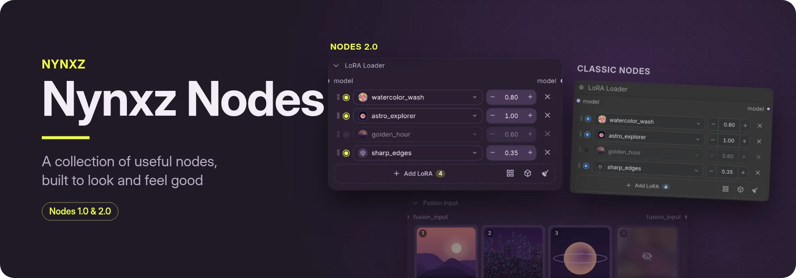
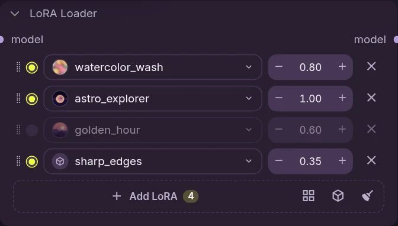
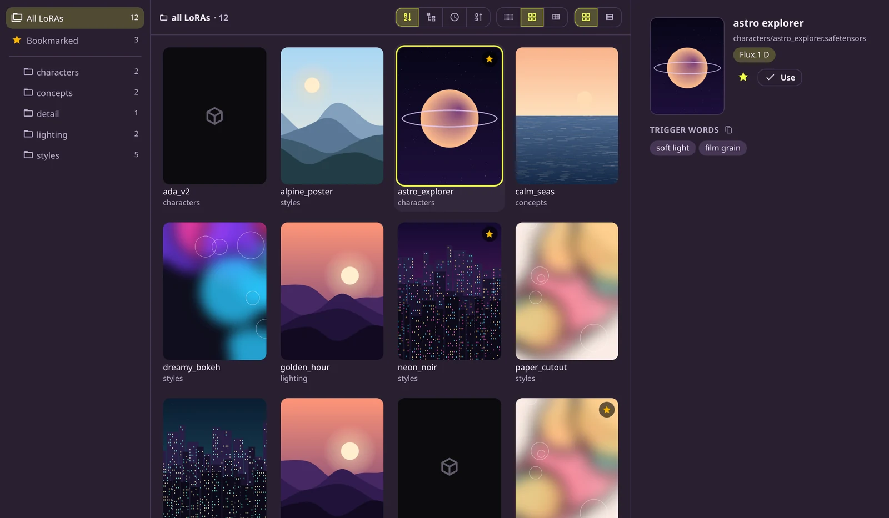
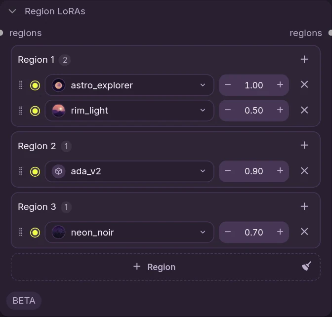
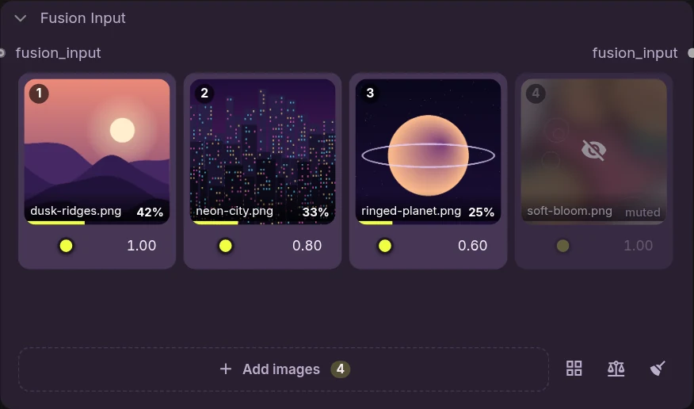
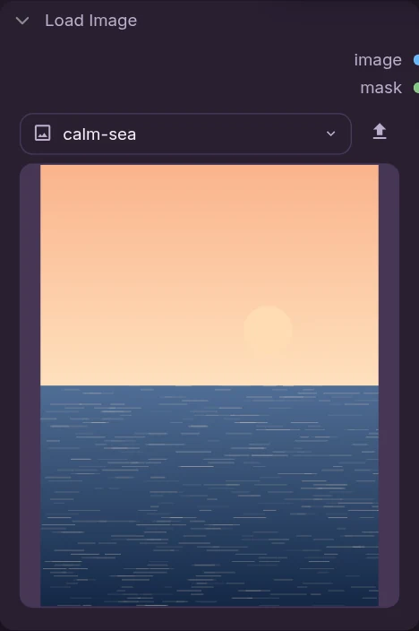
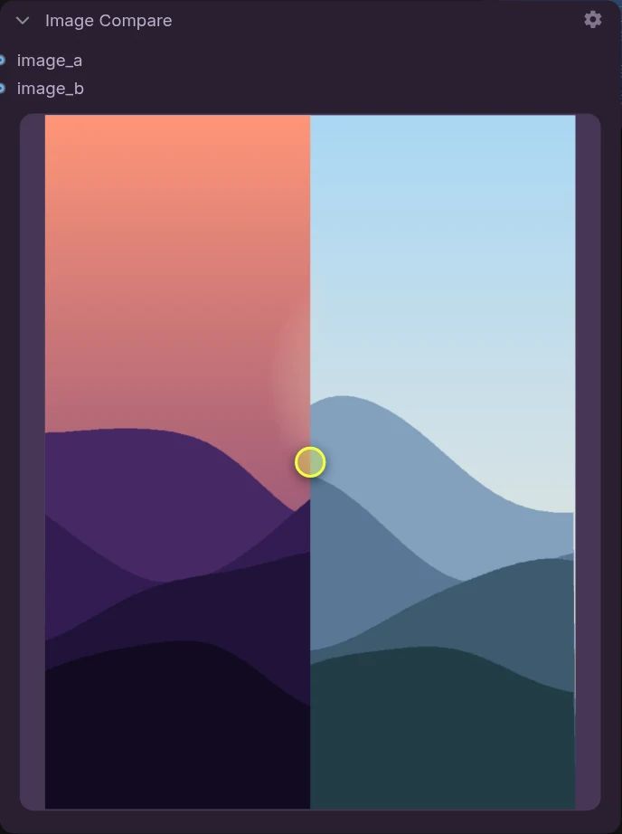

[](https://registry.comfy.org/publishers/nynxz/nodes/comfyui-nynxz-nodes)

A collection of useful ComfyUI nodes, built to look and feel good: widgets you can see and drag
instead of text boxes, previews wherever there's a picture, and less wiring for the things you do
every day.

## LoRA Loader

A whole LoRA stack on one node: turn each one on or off, set its strength, drag to reorder. The
picker searches every LoRA you have, with previews and bookmarks; hold Shift over a thumbnail for a
larger look. Set it to patch the model, the text encoder (CLIP) or both.



The browser shows the whole library by folder, as cards or a list, with each LoRA's trigger words
and examples beside it. Bookmark LoRAs, and pin the folders you use most to the top.



## Region LoRAs

Two character LoRAs on one picture usually blend into one face. Region LoRAs keeps each LoRA to its
own part of the picture: give every region its LoRAs, take the regions from masks (SAM3 can find
them for you), and character B's LoRA never touches character A. Each region can have its own prompt
too. Drag a row onto another region to move it, or a region onto another to swap them. Experimental,
and for Krea 2.



## Fusion

Blend several reference images into one edit, each with its own weight, instead of letting the
model average them. Drop pictures onto the grid, set how much each one counts, and mute one to see
what it was adding. Needs a Qwen3-VL text encoder (Krea 2, Qwen Image 2.1, Ideogram 4 and others).



## Images

<table><tr>
<td width="44%"></td>
<td><b>Load Image</b> picks from your input folder with thumbnails and search, and keeps a mask
beside the picture instead of inside it.<br><br>
<b>Image Compare</b> puts two results side by side with a slider, so you can see what a change did.
<br><br></td>
</tr></table>

## And more

- **SAM3 Detect (Signed)**: segmentation with a minus sign, like `person:2, -head:2`
- **Get from Index**: one item out of a batch of any type
- **Conditioning Sigma Gate** and **Conditioning Variation**: shape a prompt over the denoise, or
  get neighbours of the same prompt
- **Save Image** with projects and subfolders, **Grid from Images**, backgrounds and sticker outlines
- **Compare videos** (fade and wipe) and a **String Template** parser

→ [Every node, in detail](docs/NODES.md)

## Example workflows

Drag a picture onto ComfyUI to open its workflow, or find it in ComfyUI's **Templates** under this
pack. Each one has a note listing the models it needs and where to get them.

**Krea 2 Regions**: two people in a photo, each rewritten from its own region prompt, with a LoRA
per region if you have one.


## Install

Search for **Nynxz** in ComfyUI Manager, or:

```bash
comfy node install comfyui-nynxz-nodes
```

From source:

```bash
cd ComfyUI/custom_nodes
git clone https://github.com/Nynxz/ComfyUI-NynxzNodes
cd ComfyUI-NynxzNodes
pnpm install && pnpm build
```

Then restart ComfyUI. [ZenKit](https://github.com/Nynxz/ZenKit) is optional and adds pop-out
panels. The H3 nodes moved to [ComfyUI-NynxzH3Studio](https://github.com/Nynxz/ComfyUI-NynxzH3Studio);
workflows that use them open unchanged once it's installed.

Issues and pull requests are welcome. MIT licensed.
