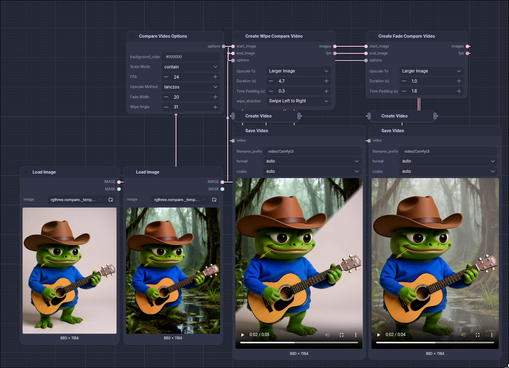
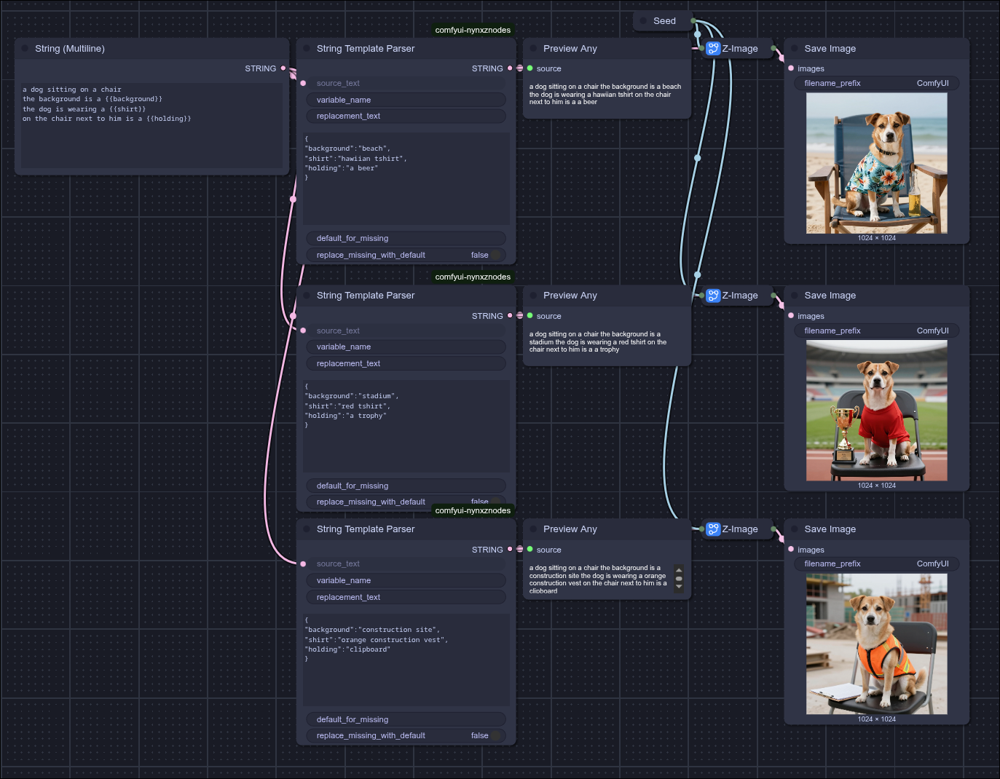

# Nynxz Nodes: every node

The full reference. The [README](../README.md) has the short tour.

## LoRA

- **LoRA Loader** — a whole LoRA stack on one node: an on/off dot, a searchable picker with
  bookmarks and previews, and a strength per row. Set it to apply to `MODEL`, `CLIP` or both.

## Fresco — paint ideas into places

_Experimental, Krea 2._ Compose a scene as layers on a canvas instead of wiring regions together.
Drag on the canvas to draw a layer, then give it what belongs there:

- a **prompt** — what this part of the picture is;
- **reference images** — dropped or browsed, each with a strength and a fit. They are read by the
  text encoder together with the layer's prompt, so their vision tokens sit in the layer's own copy
  of the prompt and only the layer's tokens read them. Several on one layer blend like Text Encode
  (Fusion). A layer with references and no prompt reads the scene prompt against them;
- **influence** — how strongly the layer follows its own prompt and references against the rest
  of the picture. Raise it when references aren't coming through;
- **LoRAs** — each runs only on the layer's tokens, at its own strength;
- a **shape** — the whole box, or paint inside it (`B` brush, `E` erase, `V` back to select,
  `[` `]` brush size); the shape moves and scales with the box. `feather` softens the edge;
- a **denoise** — for edits: how much of the source image this layer may rewrite.

Upper layers cover lower ones, like paint. The **Scene** row, pinned under the layers, holds the
scene prompt (the positive), the **background** — whatever no layer covers, with its own prompt,
references, LoRAs and denoise — and the settings (`overlap`: cover or share; `ref detail`: the
resolution references are read at).

```
CLIP ──> Fresco ── fresco ──┐
Load Model ── model ────────┤
(edit) image ───────────────┤
(edit) VAE ─────────────────┴> Fresco Apply ── model ──> KSampler / SamplerCustom
                                            ├─ positive ─> positive
                                            ├─ latent ───> latent
                                            └─ regions (for Regions Preview)
```

- **Fresco** — the editor. Takes the Krea 2 text encoder; outputs `fresco`.
- **Fresco Apply** — puts the scene on the model: each layer's LoRAs and prompt act only where it
  is (Regions Apply underneath, with the prompt copies at full weight all run), and hands the
  sampler its positive and latent. With an **image** and a **VAE** it edits that image: the latent
  is the image with each layer's denoise as its noise mask — sample it with the **SoftPaint
  Sampler**, or Differential Diffusion on the model. After a run the image shows under Fresco's
  canvas, with a one-click "match canvas" when the shapes differ. Advanced: `layout_lock` and
  `isolation`, as on Regions Apply.

Reference images on Krea 2 carry **meaning** more than exact looks — "a red floral summer dress",
not that dress stitch for stitch. Per-layer reference latents, for exact appearance, are next.

## Regions — LoRAs gated to part of the image

A LoRA cannot be masked. Conditioning can (`ConditioningSetMask` is regional prompting and it works),
but a LoRA is a _weight_ patch — merge two character LoRAs and both deltas fire on every token, so
the identities blend and no amount of prompting separates them.

These nodes keep each LoRA **unmerged** and run it as a live side branch with a per-token gate, so
character B's delta never touches character A's tokens. The gate comes from a mask, which means
`SAM3 Detect` can find the regions and you never draw anything. It composes with an ordinary
`LoraLoader` for a global style. A region can also have a **prompt of its own**, which replaces the
main prompt there, in the same single pass.

> **Krea 2 only, and experimental.** The routing map is read out of that DiT's per-block attention
> hooks; `Regions Apply` fails loudly on any other architecture rather than silently gating nothing.

```
Regions from Masks ──> Region LoRAs ──> Regions Apply ──> MODEL ──> KSampler
        └────────────> Region Denoise ──> Region Latent ──> LATENT ──┘
```

- **Regions from Masks** — a `MASK` batch becomes numbered regions. `SAM3 Detect` with
  `individual_masks` on is the intended source. `grow` is the first knob to raise when the face is
  right but the outline is wrong.
- **Region LoRAs** — the whole assignment in one node: rows grouped under the region they land on,
  each with the same picker the LoRA Loader uses. **Drag a row's grip onto another region to move
  it there**, or onto "+ Region" for a new one. Several rows may share a region; their deltas add.
  Each region has an optional **prompt** box: what that region shows, in place of the main prompt
  (write it as a whole description, style included). A region with a prompt needs no LoRA. Wire
  the Krea 2 text encoder into Regions Apply's `clip` to use them.
- **Region LoRA** — the single binding, chainable. For when the name comes from a wire.
- **Region Backdrop** — the region you'd otherwise build by hand: everything the others don't
  cover, or the whole frame. Chain it last. A LoRA on `everything` is a global one that still rides
  the commit schedule, which a stock `LoraLoader` can't.
- **Region Denoise** — how much of one region may be rewritten.
- **Region Latent** — encodes the source image and grades the denoise per region, so the background
  survives while the characters are rebuilt. Needs core's **Differential Diffusion** on the model,
  or the SoftPaint Sampler below.
- **SoftPaint Sampler** _(experimental)_ — a `SAMPLER` for SamplerCustom that reads Region Latent's
  graded mask as a soft tether to the source instead of Differential Diffusion's start times, after
  [SoftPaint](https://arxiv.org/abs/2610.00359). Low values still edit and full ones blend in
  without a seam. No Differential Diffusion needed. Costs `inner_steps + 1` model calls per step
  (3× at the default). Pixels at exactly 0 (a `protect_mask`, or `background=0`) come back as the
  source. Works with any model, with or without Regions Apply. `mask_means` picks how a mask value
  reads: `edit strength` (the paper's, edits rise evenly with the value, so mid values rebuild
  most of a region and a 0.05 background still gets redrawn) or `denoise` (Differential
  Diffusion's: held to the source until DD would start the pixel, then handed over gradually).
  Use `denoise` for region swaps on busy scenes; Region Latent's values then mean what they did.
- **Regions Apply** — patches the model. Every mechanism has an off position that recovers a
  baseline: `track=0` is a static mask, `preheat=1` is a LoRA from step 0, `refine=0` is no
  clustering. Turn them all off and this is plain regional LoRA, which is the thing to beat.
  `region_prompt` (on by default) gives each region with a LoRA its own copy of the prompt, made
  with that LoRA's text side (Krea 2's `txtfusion` layers) and carrying the LoRA in the blocks, and
  the region's tokens read it. Without it a LoRA's text side isn't applied at all, which is why
  some LoRAs looked weak here; with it a whole-canvas region matches the LoRA loaded normally. It
  costs a longer sequence and masked attention. Region prompts need it on; the negative prompt
  stays the same everywhere.
  `layout_lock` _(experimental, off at 0)_ takes the layout from the base model for that share of
  the steps, after [QK-Edit](https://arxiv.org/abs/2610.17829): each of those steps first runs
  without the region LoRAs, and the real pass uses that pass's image queries and keys, so the
  LoRAs can run at full strength from step 0 without moving the composition. Try `0.25` with
  `preheat=1`. It costs a second pass on those steps and about 1.75 GB per image at 1024².

For **NK2E edits with seams**, keep the edit LoRA loaded normally and the source image connected
as reference conditioning. In **Region Latent**, try `background=0`, `flatten=0`,
`context_radius=32`, and `context_denoise=0.18`, keeping the region denoise that already produces
the desired edit (for example, `0.97`). Use **Differential Diffusion** on the sampling model.
The context band gives nearby pixels some freedom to adapt late in sampling, fading to zero
within the chosen radius in source-image pixels. This changes the denoise mask only; it does not
expand the regional clothing LoRA's gate. Keep Regions Apply's global `release=0` for this test.
Leave the source-reference configuration that works with your edit checkpoint unchanged.

An optional **`protect_mask`** on Region Latent uses white for protected areas such as the face
and hands, overriding region, background, context denoise, and flattening. Supply one mask for all
source images or a matching batch. Protection operates on latent cells, conservatively retaining
small protected features; it does not guarantee identical RGB pixels after VAE decoding. Preview
the existing `denoise_mask` output to check the repair band and protected areas. Radius `0`
disables the new band and is the default, preserving existing workflows.

Two nodes exist only to answer "what actually happened", so the working nodes don't each carry a
report socket:

- **Region Inspect** — tap the regions wire anywhere: every mask as a `MASK` batch you can edit and
  feed back, a colour preview of all of them at once, and the bindings. The _pre_-sampling view.
- **Regions Preview** — the gate map that actually ran, against the mask it started from, so a bad
  mask, a subject that moved, and a LoRA bleeding for some other reason stop looking alike. Wire the
  sampler's `LATENT` in to sequence it after the run. The _post_-sampling view.

## SAM3 — segmentation with subtraction

- **SAM3 Detect (Signed)** — core's `SAM3 Detect` with a minus sign. Prefix any term with `-` and
  it is removed from what the other terms found:

  ```
  person:2, -head:2      two people, minus their heads
  woman, man, -hands     both subjects, minus every hand
  ```

  The syntax is SAM3's own `category:N`, unchanged — a prompt with no `-` in it means exactly what
  it means in the stock node. The node takes `CLIP` and a prompt where stock takes a
  `CONDITIONING`, and that is not a style choice: core parses `category:N` in the _tokenizer_
  (`_parse_prompts` in `comfy/text_encoders/sam3_clip.py`) and hands the detector anonymous
  `(embedding, max_detections)` pairs, so a sign written into a `CLIPTextEncode` would be gone
  before the node could read it. Encoding each term here is what keeps the sign attached to it.

  **`N` means something different on a negative.** On a positive it is core's own default of 1,
  trap and all — `person` finds one person, `person:2` finds two. On a negative it defaults to
  _all_ matches, because subtracting one of the two heads in frame leaves the other one sitting in
  the mask. Write `-head:2` to cap it.

  Two knobs beyond stock's, both advanced. **`negative_grow`** (4px) dilates the negatives before
  removing them: a negative traces its own silhouette, so an exact subtraction leaves a ring of its
  edge behind — a collar of neck where a head was. **`drop_empty`** (off) discards positives the
  negatives consumed entirely, instead of emitting a blank mask; it is off by default because
  dropping one renumbers everything after it, and region numbers are what **Region LoRAs** binds
  to. `bboxes` are measured from the mask _after_ subtraction, so a box and its mask always
  describe the same pixels.

  Subtraction is union-then-remove: every negative in a frame merges into one keep-out mask that
  comes off each positive. Under occlusion — person B's head overlapping person A's body — that
  punches a hole in A. Matching each negative to the positive containing it would fix that, and is
  not implemented.

## Fusion — several reference images in one conditioning

Wire two references into an edit and the model gets one after the other; it takes what it likes
from each and the result is an average. Regional _prompting_ can't fix that — there's only one
visual block to prompt against. So the blend happens inside the conditioning: each source is
encoded independently through the Qwen3-VL vision tower, and their visual tokens are mixed token by
token under a weight field you control — by spatial pattern or by content.

> Needs a **Qwen3-VL text encoder** (`qwen3vl_4b` / `qwen3vl_8b`) — hence `Text Encode (Fusion)`
> rather than any one model's name. Krea 2 and Mage-Flow at 4B; **Qwen Image 2.1** and Ideogram 4
> at 8B. The node detects which is wired and adapts the chat template, alpha handling and
> reference sizing to it.

**Qwen Image 2.1 is built differently, and it changes what you fuse.** Krea 2 and
Qwen-Image-Edit 2509 trim only the system prefix from their conditioning, so the vision tower's
tokens stay in it and the DiT consumes them as semantic conditioning — that is the lever this
group blends. 2.1 _deletes_ those tokens and splices VAE reference latents at `image_slots`
instead, through a separate `img_in` path (2D RoPE, bidirectional block attention) distinct from
its causal text path. The vision tokens are a discarded intermediate whose job was to
contextualise the text.

So on 2.1 the reference's **semantics** survive in the text tokens and its **pixels** arrive as
latents. `reference_mode` picks what the weight field acts on:

| mode                | blends                                                                                                              | needs                |
| ------------------- | ------------------------------------------------------------------------------------------------------------------- | -------------------- |
| `reference latents` | the VAE latents the DiT receives (as ONE fused reference) **and** the per-image text readings — the trained path    | 2.1 + a VAE          |
| `visual tokens`     | the vision tower's tokens inside the text stream — the normal path on Krea 2 / Edit, **out of distribution on 2.1** | any Qwen3-VL encoder |
| `auto` (default)    | reference latents on 2.1 with a VAE; visual tokens otherwise                                                        | —                    |

`visual tokens` on 2.1 is core's own no-VAE fallback: it forces `keep_vision` so the tokens
survive, then pushes them through the _text_ projection at causal text positions that hold no
vision tokens in training. It runs, and it is interesting to experiment with, but it is not what
2.1 was trained on — wire a VAE and let `auto` take the latent path.

**Pixels and meaning travel separately on 2.1, so they get separate knobs.** In reference-latent
mode the spliced latent is the reference's _pixels_; the text conditioning is the vision tower's
_reading_ of it. Two controls:

- **`structure_source`** — where the spliced latent comes from. `fused` (default) blends every
  source under the weight field. `strongest` / `first` hand one source's latent through whole.
- **`semantic_strength`** — how much the per-source text readings blend. `1.0` (default) mixes
  every source by its share of the field; `0.0` uses the structure source's reading alone.

Which makes "**this one's composition, everyone's ideas**" a two-widget setting:

```
structure_source:  strongest     ← the highest-strength image anchors the pixels
semantic_strength: 1.0           ← every image still contributes its meaning
```

Set `semantic_strength` to `0.0` alongside a non-fused `structure_source` and you get a plain
single-reference encode — useful as an A/B against the blend. Both knobs are inert on every other
encoder, which blends visual tokens instead.

2.1 shares one resize between its vision tower and its VAE, so `visual_size` sets the reference
resolution there as well — raise it to ~1024 on 2.1 (the 384 default suits the token-only blend).
The node's `latent` output hands back a correctly shaped empty canvas (64-channel at 1/16 for
2.1), which otherwise only core's own encode node produces.

```
Fusion Input ─┐
              ├─> Text Encode (Fusion) ──> CONDITIONING ──> KSampler
Fusion Images ┘             ├────────────> latent ────────> KSampler
                            └────────────> fusion_inspect ──> Fusion Inspector
```

- **Fusion Input** — drop images onto an on-node grid; each carries its own strength, fit and mute,
  and they reorder by dragging. Reads files from `input/`, `temp/` or `output/` so every card shows
  a real thumbnail.
- **Fusion Images** — the wire-side collector: plain `IMAGE` sockets with one shared strength and
  fit. Chains with the grid either way round. Alpha is still per-image, because the mask travels
  inside the image.
- **Text Encode (Fusion)** — the node that does the work. Prompt plus the fusion tuning.
- **Fusion Inspector** — hover the token grid to see which source won which cell, the per-source
  shares, and the settings that produced them. It shows the field that actually ran, captured
  inside the encode.

**Masking a source with alpha.** An image with an alpha channel only contributes where it is
opaque. Cut an element out and it is _absent_ from the blend rather than dimmed — its share of
every token it covered goes to the other sources, and the pattern reflows to close the gap. That
is how you remove an unwanted element from a reference:

```
Load Image ──> image ──┐
             └> mask ──┴> Join Image with Alpha ──> Fusion Images ──> Text Encode (Fusion)
```

Core's `Join Image with Alpha` turns a `MASK` into the alpha channel; a transparent PNG dropped on
the Fusion Input grid works the same way. Masked pixels are composited to neutral grey before the
encoder sees them, so the removed element cannot leak back in through the vision tower's global
attention, and the same treatment is applied to the `vae` reference latents. Images without an
alpha channel are unaffected. Set `alpha_mode` to `ignore` on the encode node to blend the RGB
whole and pretend the alpha isn't there.

Fusion and the Regions group are separate things that share a word: fusion decides _which reference
wins a token_, Regions decides _which LoRA fires on one_.

## MiniMax H3

The H3 nodes — H3 Reference, H3 Mood Board, H3 Reference to Video — moved to
[ComfyUI-NynxzH3Studio](https://github.com/Nynxz/ComfyUI-NynxzH3Studio), the H3 production pack, together
with H3 Studio, Grey Box Studio and the Codex. Their node ids are unchanged, so workflows that use
them open as before once that pack is installed.

## Batch

- **Get from Index** — one item out of a batch of **any** type. Core needs a different node per
  type (`Get Image from Batch`, `Latent From Batch`); this works the batch dimension out from the
  value itself and uses `MatchType`, so the output socket takes whatever type you wired in and
  the graph still type-checks.

Handles every way ComfyUI batches something:

| type                     | batched on                                       |
| ------------------------ | ------------------------------------------------ |
| `IMAGE`, `MASK`          | a tensor's first dimension                       |
| `LATENT`                 | `samples`, with `noise_mask` sliced alongside it |
| `AUDIO`                  | `waveform`, keeping `sample_rate`                |
| `CONDITIONING`, any list | list entries                                     |

Index conventions match core's, so it is not a surprise next to the nodes it replaces: negative
counts from the end (`-1` is the last), and the result **keeps its batch dimension**, so it drops
straight back into anything that took the original. `length` takes a sub-batch instead of a
single item, trimmed to what is actually there.

`out_of_range` decides what an index past the end means — `clamp` (core's behaviour, the
default), `wrap` for driving it from a counter, or `error` when out-of-range means something
upstream is wrong. The node also outputs the `index` it actually used and the batch `count`, so a
clamped or wrapped index is visible rather than guessed at.

## Conditioning

- **Conditioning Sigma Gate** — restrict any conditioning to a slice of the denoise, in denoise
  percent or real sigma. Intersects with whatever schedule the conditioning already carries, so it
  stacks instead of overwriting.
- **Conditioning Variation** — a variation seed for the _prompt_. Nudges a conditioning in a seeded
  random direction so you get neighbours of the same prompt with the sampler seed untouched. The
  nudge is direction-only: each token keeps its magnitude, so the variation changes content rather
  than loudness.

## Create Compare Video

- Fade Compare Video
- Wipe Compare Video



## String Template Parser


